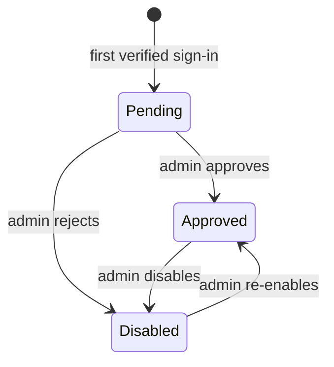
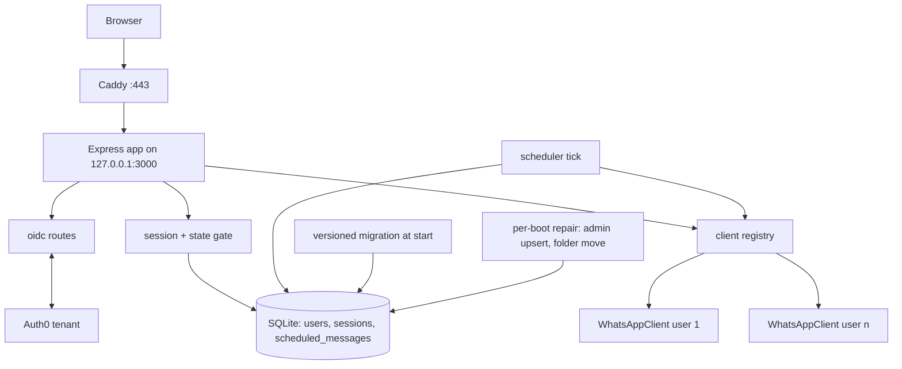
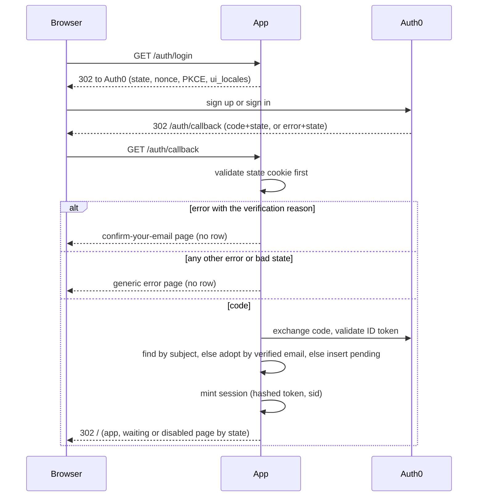
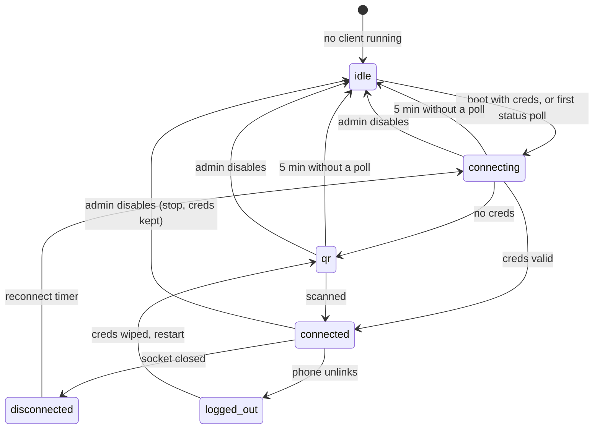
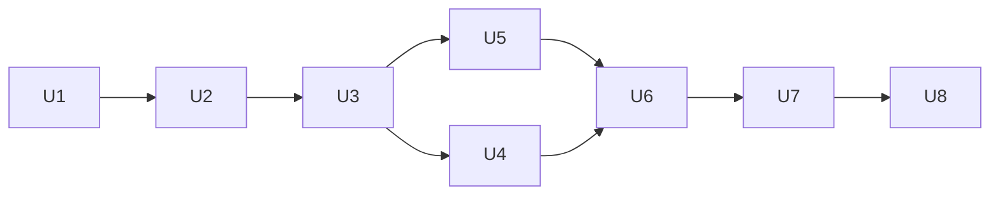

# Auth0 Multi-User Access - Plan

## Goal Capsule

- **Objective:** Up to ten approved people each run the scheduler against their own WhatsApp account from a public address, and one admin decides who gets in and can stop anyone at once.
- **Means:** Auth0 sign-in through a direct OpenID Connect integration (KTD1), one WhatsApp client per user (KTD4), app-owned account states with an immediate reversible pause (KTD3, KTD5), and a Caddy reverse proxy on the existing VM (KTD9).
- **Product authority:** The Product Contract below. Key Decisions are settled; the Planning Contract chooses how, and a unit overrides neither.
- **Execution profile:** Eight units in five phases, all in this repository, plus a runbook for steps only the admin can perform (Auth0 tenant, DNS, Oracle console). Verification is `npm test` plus the smoke checks in the Verification Contract. Do not run `deploy/redeploy.sh` for U1 through U7: the VM has no environment file until the runbook's step 4, the new code exits without it, and the cutover must follow the backup step. The first deployment of this work is runbook step 5 in U8.
- **Stop conditions:** Stop and report if the memory measurement in U8 shows two linked phones already exhaust the VM, if Baileys rc14 cannot link a real phone, or if any check in the Verification Contract cannot be made to pass without changing a Key Decision.
- **Who finishes:** The implementer lands U1 through U7 and the repo side of U8. The admin performs the runbook steps in U8 and the cutover; the implementer verifies the result.
- **Open blockers:** None. The public hostname is an admin input consumed by U8.

---

## Product Contract

**Product Contract preservation:** changed: R25 and new R27, R28 — Auth0 returns a newly signed-up person to the app before the email is verified, so a fourth state page was added (R27), and a recurring series must survive a missed occurrence during a pause (R28). Both were confirmed in the pre-write synthesis. All other requirements and IDs are unchanged.

### Summary

Turn the single-login scheduler into a multi-user one. People sign up through Auth0, wait for the admin's approval, then link their own phone and schedule messages that only they can see. The admin can pause any account instantly and reversibly. The app moves to a public HTTPS subdomain so Auth0 and the users can reach it.

### Problem Frame

The app has one shared login driving one WhatsApp link. Anyone let in acts as the owner: they see every scheduled message and can unlink the phone. Adding a person means running a command on the server, and removing one means changing the shared password. The owner now wants up to ten people using the tool, each with their own phone, without them seeing each other's work and without the owner being able to see theirs. Production is reachable only through an SSH tunnel, which ten people cannot use.

### Actors

- A1. **Admin.** The owner. Approves, rejects, disables and re-enables accounts. Is also a user (A2) with their own link and schedule.
- A2. **User.** An approved person. Links and unlinks their own WhatsApp, manages their own groups and messages.
- A3. **Pending visitor.** Has an Auth0 account and has signed in, but is not yet approved. Sees only a waiting page.
- A4. **Auth0.** Holds credentials, verifies email addresses, hosts the sign-in page, reports the verified email to the app.

### Key Decisions

- **Auth0 is the identity provider.** Hosted sign-in, password reset and no stored passwords, for one tenant's worth of configuration. (session-settled: user-approved — chosen over direct Google sign-in and self-sent email magic links: those save the tenant but push password or email handling into the app.) Governs R1, R3.
- **Email and password is the only sign-in method.** The users will log in with email. (session-settled: user-directed — chosen over passwordless codes and Google, Apple or Microsoft accounts.) Governs R1.
- **The built-in login is removed, not kept beside Auth0.** Two sign-in paths would mean two revocation paths. Governs R2.
- **Each user has their own WhatsApp link and schedule, and the admin is also a user.** (session-settled: user-directed — chosen over an admin-only account with no link, and over today's one shared link: the owner wants to keep scheduling and must not see other people's data.) Governs R15, R16, R17, R18.
- **People sign in first and are approved afterwards.** No emails to type ahead, and the address arrives verified. (session-settled: user-approved — chosen over a pre-entered allowlist: a typo there locks a person out.) Governs R6, R7.
- **Disabling pauses everything and is reversible.** Disable must stop activity, not only block the login page. (session-settled: user-approved — chosen over blocking login only, which leaves the phone sending, and over a full wipe, which forces a fresh QR scan on return.) Governs R10, R11, R12.
- **The app owns access state and the admin page.** Immediate pause needs the app to act on its own connections, and the admin stays inside the product. (session-settled: user-approved — chosen over approving and blocking in the Auth0 dashboard: a block there does not reach a live connection.) Governs R5, R20.
- **The app lives on a subdomain of the owner's domain over HTTPS.** (session-settled: user-directed — chosen over buying a domain, a dynamic-DNS name, or staying private behind SSH.) Governs R22, R23, R24.
- **Rejecting a pending account disables it.** The person cannot re-enter the queue by signing in again. Governs R8.
- **There is exactly one admin, set by server configuration.** No in-app promotion at this scale. Governs R21.
- **The current link and schedule become the admin's own.** Nothing is lost at cutover. Governs R19.
- **A message that comes due while its owner is disabled is missed, not sent late.** Sending days-old reminders on re-enable would surprise recipients. This differs from a disconnected phone, where today's behavior of sending on reconnect stays. Governs R12.
- **Signing out of the app also ends the Auth0 session.** Otherwise the next person at the same browser is let straight back in. Governs R4.
- **An unverified email gets its own page and no account.** Auth0 returns a fresh sign-up to the app before the verification link is clicked, and the admin must never see an unverified address. Governs R27.
- **A recurring series survives a missed occurrence.** The standing reminder continues from the next future occurrence rather than dying or firing late. Governs R28.

### Requirements

**Identity and sign-in**

- R1. Sign-in goes through Auth0 with email and password as the only method, and the app stores no passwords.
- R2. The built-in email-and-password login, its sign-in page and the command-line user creation are removed, so no path signs in without Auth0.
- R3. The app identifies a person by the email Auth0 reports, and a person enters the pending state only after Auth0 has verified that email.
- R4. Signing out of the app ends the Auth0 session too, so the next sign-in on that browser asks for credentials.

**Access states and approval**

- R5. Every account is in exactly one of three states: pending, approved, disabled.
- R6. A person's first sign-in creates a pending account automatically, and a pending account can reach only a waiting page.
- R7. The admin can approve a pending account, and the person gets full access on their next request without signing in again.
- R8. The admin can reject a pending account, which moves it to disabled.
- R9. The admin can disable an approved account and re-enable a disabled one.
- R10. Disabling takes effect at once: every session of that account is ended, its WhatsApp connection is closed while the link is kept, and its queued messages are held.
- R11. Re-enabling reconnects the account's WhatsApp link and resumes its queue.
- R12. A queued message whose send time passed while its owner was disabled is marked missed and is never sent.
- R13. A pending or disabled person who opens the app sees a page that names their state, in place of a generic error.
- R14. The admin cannot reject or disable their own account.

**Per-user isolation**

- R15. Each approved user links their own WhatsApp account by QR code and can unlink it, and that link belongs to that user alone.
- R16. A user sees and manages only their own groups and scheduled messages.
- R17. No account, the admin included, can view another user's groups, messages or link state, or link and unlink on their behalf.
- R18. The admin account is also a regular user with its own WhatsApp link and schedule.
- R19. At cutover, the existing WhatsApp link and every existing scheduled message become the admin's own.

**Admin page**

- R20. The admin page lists every account with its email, state, sign-up time and last sign-in, with approve, reject, disable and enable actions, and shows nothing from any user's schedule or WhatsApp.
- R21. The admin is designated by server configuration, one account at a time, and the app offers no way to grant admin.

**Public reachability**

- R22. The app is reachable from the public internet over HTTPS at a subdomain of the owner's domain, which is also where Auth0 returns people after sign-in.
- R23. Requests over plain HTTP are redirected to HTTPS.
- R24. The SSH tunnel stops being the way in; nothing in the app assumes a localhost origin.

**Language**

- R25. New pages (unverified email, waiting, disabled, admin) follow the app's existing Russian-first, English-switchable pattern.
- R26. The Auth0 sign-in page is offered in Russian and English.

**Clarifications confirmed at planning**

- R27. A person whose Auth0 email is not yet verified sees a page telling them to confirm it and sign in again, and no account is created for them.
- R28. When a recurring message's occurrence is missed during a pause, the series continues from the first occurrence after re-enable, and only the held occurrence is marked missed.

### Key Flows

- F1. **A new person joins**
  - **Trigger:** The admin gives someone the app's address.
  - **Actors:** A3, A4, A1
  - **Steps:** The person creates an Auth0 account with email and password. Auth0 returns them to the app; if the email is not yet verified they see the confirm-your-email page (R27), click the link in the email, and sign in again. The app then creates a pending account and shows the waiting page. The admin opens the admin page, sees the pending email and approves it. On the person's next request the main app loads; they scan the QR code and their phone is linked.
  - **Covered by:** R1, R3, R6, R7, R15, R20, R27

- F2. **Everyday use**
  - **Trigger:** An approved user opens the app.
  - **Actors:** A2
  - **Steps:** Auth0 signs them in or their session is still valid. The app shows their own link status, their own groups and their own messages. They schedule, cancel and delete as today, within their own data only.
  - **Covered by:** R15, R16, R17

- F3. **Pausing and restoring a user**
  - **Trigger:** The admin clicks disable on an approved account.
  - **Actors:** A1, A2
  - **Steps:** The account becomes disabled. Its sessions end, its WhatsApp connection closes with the link kept, and its queue is held. The user's next request shows the disabled page. Later the admin clicks enable: messages whose time passed are marked missed and recurring series are moved forward (R28), then the connection comes back and held messages still in the future resume.
  - **Covered by:** R9, R10, R11, R12, R13, R28

- F4. **Cutover from the old login**
  - **Trigger:** The new version is ready to deploy.
  - **Actors:** A1, A4
  - **Steps:** The admin creates their Auth0 account with the email configured as admin. The new version is deployed on the public hostname; at start-up it creates the approved admin account and assigns the existing link and schedule to it. The admin signs in through Auth0 and finds them under their account. The old login page and user command no longer exist.
  - **Covered by:** R2, R19, R21, R22

### Acceptance Examples

- AE1. **Pending user tries to schedule.** Covers R6, R13.
  - **Given** a person who signed in but is not approved
  - **When** they open any page or call any scheduling action
  - **Then** they get the waiting page and no data or action goes through.

- AE2. **Approval reaches an open tab.** Covers R7.
  - **Given** a pending person with the waiting page open
  - **When** the admin approves them and they reload
  - **Then** the main app loads without a new sign-in.

- AE3. **Disable holds the queue, re-enable marks the missed ones.** Covers R10, R11, R12.
  - **Given** an approved user with one message due in 5 minutes and one due tomorrow
  - **When** the admin disables them and re-enables them 30 minutes later
  - **Then** the 5-minute message is marked missed and never sent, and tomorrow's message sends on time.

- AE4. **An existing session dies on disable.** Covers R10, R13.
  - **Given** a user signed in on their phone and on a laptop
  - **When** the admin disables them
  - **Then** the very next request from either device shows the disabled page and returns no data.

- AE5. **No cross-user reads.** Covers R16, R17.
  - **Given** users A and B, each with scheduled messages
  - **When** A requests a message, group list or link status that belongs to B, including by guessing an identifier
  - **Then** A gets nothing of B's.

- AE6. **The admin cannot lock themselves out.** Covers R14.
  - **Given** the admin on the admin page
  - **When** they try to disable or reject their own account
  - **Then** the action is refused and their state is unchanged.

- AE7. **A rejected person stays out.** Covers R8, R13.
  - **Given** a person the admin rejected
  - **When** they sign in again through Auth0
  - **Then** they see the disabled page and do not reappear as pending.

- AE8. **Cutover keeps the owner's work.** Covers R19.
  - **Given** the pre-cutover database with the owner's scheduled messages and linked phone
  - **When** the owner signs in through Auth0 for the first time after deployment
  - **Then** the same messages and the same linked phone are shown under their account.

- AE9. **Sign-out really signs out.** Covers R4.
  - **Given** a signed-in user
  - **When** they click sign out and then open the app again
  - **Then** Auth0 asks for email and password.

- AE10. **Unverified sign-up creates nothing.** Covers R3, R27.
  - **Given** a person who just signed up in Auth0 and has not clicked the verification link
  - **When** Auth0 returns them to the app
  - **Then** they see the confirm-your-email page, the admin page lists no account for them, and after verifying and signing in again they appear as pending.

- AE11. **A weekly reminder survives a two-week pause.** Covers R12, R28.
  - **Given** a weekly message due every Monday 09:00 and a user disabled for 16 days starting Sunday
  - **When** the admin re-enables them
  - **Then** the first Monday's occurrence is marked missed, no occurrence is sent for either missed Monday, and the next pending occurrence is the Monday after re-enable.

### Success Criteria

- Ten accounts with linked phones stay connected at the same time on the production host without the process being killed for memory, measured before access is opened beyond the owner.
- A disable is visible to the affected person on their next request, never later than that.
- The app's database holds no password hashes after cutover.

### Scope Boundaries

Deferred for later:

- Sign-in methods other than Auth0 email and password.
- Invitations or a pre-approval allowlist.
- More than one admin, or roles beyond admin and user.
- An admin view of each user's connection health or last send result.
- Notifying the admin when someone is waiting for approval.
- Enforcing multi-factor authentication.
- An audit history of admin actions.
- Self-service account deletion or data export.
- Sharing one WhatsApp link between several users.
- Moving off the current Oracle Cloud VM.
- A "resend verification email" button, which needs the Auth0 Management API and a machine-to-machine application.

Considered and not built:

- A SQLite-backed Baileys credential store. Per-user folders are what the library documents and are adequate at ten users; revisit if file churn or backup becomes a problem.
- Blocking disabled users inside Auth0 as well. The app-side gate is authoritative and immediate; an Auth0 block would need a Management API client for no user-visible gain.
- Rate limiting on the sign-in routes. Auth0 already throttles brute force; the app's callback does one database write per sign-in. Revisit if pending-row spam appears.
- A CSRF token. Cookies are SameSite=Lax and state-changing routes pass a same-origin check (KTD11), which closes the cross-site and sibling-subdomain cases at this scale.
- Keeping Auth0 sign-ups switched off except while onboarding a known person. It would stop strangers from exhausting the verification-email quota, but it changes the confirmed sign-in-then-approve flow into a toggle the admin flips per person. Recorded for the owner as an option; the trigger to adopt it is verification emails being throttled or a flood of pending rows.
- A NOT NULL constraint on the message owner column. SQLite cannot add it to a populated table without a rebuild; the create path refuses an ownerless insert and a boot-time check reports any ownerless row instead (KTD8).

#### Deferred to Follow-Up Work

- Rewriting the Fly.io deployment section and `fly.toml` for the new login. They are not the production path and are left as-is with a note.

### Dependencies / Assumptions

- The admin creates the Auth0 tenant and application and supplies its credentials to the server; U8 states where they live.
- The admin points a subdomain of a domain they already own at the VM; opening the port on Oracle's network list and the VM firewall, a reverse proxy and automatic certificates are part of this work.
- Up to ten users is the planning ceiling. No specific person has asked yet; the headcount is the admin's estimate.
- The production VM has 951 MB of memory and no swap, and the service idles at about 150 MB with no linked phone. Ten live WhatsApp connections may not fit; U8 adds swap, measures with two linked phones, and states what happens when the figure is too high: a move to the larger free-tier shape when the region has capacity, otherwise a lower user ceiling on the current VM.
- Auth0's free plan covers 25,000 monthly active users, five Actions and one day of log retention, and includes brute-force protection but not bot or breached-password detection.
- Production currently has an empty credential folder and no scheduled messages. The cutover migration is exercised against the local data directory, which holds a linked phone but no message rows, so the migration test seeds messages; on the server the admin will scan a fresh QR.
- The project is not under version control and deploys by file sync to the VM. The cutover preserves the data directory and runs the admin bootstrap before the old login is gone.

### Outstanding Questions

Resolve Before Planning: none.

Deferred to implementation:

- The exact public hostname. The admin supplies it when U8 is executed; the code reads it from configuration.
- Whether the Oracle home region currently offers Always Free A1.Flex capacity. The admin checks it when the memory figure is recorded in U8; without capacity the user ceiling is whatever the current VM supports.
- Whether Baileys rc14 still exports every symbol the client uses. U3 greps the installed package before relying on them.
- The measured memory per linked phone. U8 records it and decides whether the VM shape must change.
- Whether the tenant's discovery document exposes an end-session endpoint. U5 falls back to the legacy logout endpoint if not.
- Whether the tenant accepts `logout_hint` with the session id claim, which lets the app store only that claim instead of the ID token. U5 checks it against the development tenant and keeps `id_token_hint` as the fallback.

### Sources / Research

- `src/auth.js`, `src/server.js`, `src/db.js`: the current login, session cookie and schema. The users table has only email and password hash; sessions end by deletion or expiry; no route checks a role or ownership.
- `src/whatsapp.js`, `src/config.js`: one WhatsApp client instance for the whole process, credentials in one directory under the data directory. `WhatsAppClient.stop()` already closes the socket while keeping credentials; `logout()` is the destructive one and restarts the socket immediately.
- `src/scheduler.js`, `src/recurrence.js`: messages due while disconnected stay pending and send on reconnect; a recurring series advances one period only after a row ends as sent or failed.
- `scripts/create-user.mjs`: the only way users are created today; removed by R2.
- `deploy/court-scheduler.service`, `deploy/redeploy.sh`, `deploy/setup-vm.sh`, `README.md` (Option B): systemd unit with environment lines and no secrets file, rsync deploy without `--delete` that never copies the unit file, no proxy or TLS on the VM. The VM's own firewall already allows port 3000; only the Oracle network layer blocks it today.
- `public/index.html`, `public/login.html`: the Russian-first, English-switchable UI pattern; the page helper redirects every 401 to the login page and knows no 403.
- openid-client 6.8.8 (ESM, Node 20+): discovery, PKCE helpers, authorization-code grant with validated ID-token claims, end-session URL builder. express-openid-connect 3.4.0 wraps it, allows Express 5 by peer range but is tested on Express 4 only.
- Auth0: `/oidc/logout` with `id_token_hint` and an exact `post_logout_redirect_uri` is current; `/v2/logout` is legacy but not deprecated. Universal Login supports Russian via tenant `enabled_locales` plus `ui_locales`. A post-login Action can deny unverified emails. Free plan: 25k MAU, 5 Actions, 1-day logs, no bot detection.
- Baileys 7.0.0-rc14: no stable 7.0, ESM-only, security fix landed in rc12, `useMultiFileAuthState` is documented as a guide only, no official multi-socket guidance. `fetchLatestBaileysVersion` performs a network fetch on every call.
- Node 24: `node:sqlite` enables foreign keys by default and supports `ALTER TABLE DROP COLUMN`; `node --test` isolates each file in its own process, so a test can set `DATA_DIR` before a dynamic import.
- Verified on a copy of the local data directory with SQLite 3.53.3: `ADD COLUMN ... UNIQUE` is refused, so uniqueness needs a separate index; DDL including `DROP COLUMN` is transactional and rolls back cleanly; `VACUUM INTO` produces a self-contained backup under WAL, whereas a copy of the main file without its WAL has no tables; a directory cannot be renamed into its own subdirectory; the old code cannot start once `password_hash` is gone.
- Caddy 2.11: official apt repo installs a systemd unit running as its own user with the bind capability; a hostname-only site block gives automatic HTTPS and an HTTP-to-HTTPS redirect.

---

## Planning Contract

### Key Technical Decisions

- KTD1. **Integrate Auth0 directly with openid-client and keep the app's own session table and cookie.** Three routes (login, callback, logout) mint the app's random-token session, so disabling a user is one session delete and no second session layer exists. Sessions store a SHA-256 hash of the token and the ID token's `sid` claim for logout, or the ID token itself when the development-tenant check in U5 shows the tenant refuses `logout_hint`; the raw token lives only in the cookie. Expiry stays absolute at 30 days. Chosen over express-openid-connect, which is tested only on Express 4 and brings its own cookie session. (session-settled: user-approved — Auth0 chosen over direct Google sign-in and self-sent email magic links: hosted login and password reset with no stored passwords.) Cites R1, R2, R3, R4, R10.
- KTD2. **Accounts are keyed on the Auth0 subject; email is stored for display and for the admin match, and a row without a subject is adopted by verified email once.** Callback lookup order: by subject; else by normalized email where the subject is still empty, which attaches the subject and keeps the row's id and state; else insert pending. A different subject claiming an existing email is refused. Only subjects from the database connection (prefix `auth0|`) are accepted at all. The admin is whichever approved account's email equals the configured admin email, compared after the same lowercase-and-trim normalization on both sides, evaluated per request, and refreshed from the claim on every callback. R3's "identified by the email Auth0 reports" is what the admin and the person see; the subject is the internal key that keeps that email attached to one account. Cites R3, R21.
- KTD3. **Account state is enforced on every request from the database; the disable state flip and session delete share one transaction, and the enable state flip and missed sweep share another.** The per-request check makes approval visible on the next request; the delete makes an old cookie worthless even if a check were skipped; the enable transaction means the scheduler can never observe "approved" before the sweep has run. A disabled person's next request therefore answers 401, the browser goes to sign-in, Auth0's own session signs them back in without a prompt, the callback mints a session for the disabled account, and `/` shows the disabled page: no data is returned and the disabled page is what they see, which is how AE4 is met. (session-settled: user-approved — app-owned state chosen over the Auth0 dashboard: a block there does not reach a live connection.) Cites R5, R7, R10, R13.
- KTD4. **One WhatsApp client instance per user in an in-process registry, credentials in `data/wa/<userId>`, a sibling of the legacy folder.** The existing client class gains constructor injection of its folder, logger and socket factory; the Baileys version is fetched once per process and shared; a per-client generation counter makes a stop during an in-flight start win. The folder path is built only from a positive integer id by one function, never from an email or claim. No route resolves a client from anything but the gate-attached user; the registry offers no lookup by request parameter. A client starts at boot only when its user is approved and has saved credentials, otherwise on that user's first status poll, and a client that has sat in QR or connecting for 5 minutes without a status poll is stopped. (session-settled: user-directed — per-user links with the admin also a user, chosen over one shared link and over an admin-only account.) Cites R15, R16, R17, R18.
- KTD5. **Pause is the client's existing stop plus owner filters in the due query and in claim; resume is a transactional sweep, then start.** The due query returns only rows with an owner whose state is approved; the tick skips, without claiming, any row whose owner's client is not connected, since connection state lives in the process, not the database; claim re-checks the owner's state in the same statement, so a user disabled after the tick's snapshot is still not sent. Enable runs the state flip and the sweep in one transaction, then starts the client, so the connect-triggered tick finds only future rows. A row already claimed when its owner is disabled may consume one retry attempt; the enable sweep then marks it missed if its time has passed. (session-settled: user-approved — reversible pause chosen over blocking login only and over a full wipe.) Cites R10, R11, R12, R28.
- KTD6. **The missed sweep marks every pending row with a past send time as missed and fast-forwards recurring series under a one-pending-per-series guard.** For a missed recurring row the next occurrence is computed repeatedly from the series anchor until it lands after now, and one future row is inserted only when the series has no other pending row; it carries the series id, owner, group and text of the missed row. A series whose anchor row was deleted falls back to the missed row's own time as anchor. `missed` is a new terminal status, deletable like `failed`. Cites R12, R28.
- KTD7. **The cutover is one versioned database transaction with a backup before it, and the credential folder move is a separate per-boot repair step.** When the schema version is 0 and the password column exists, the process first writes a self-contained backup with `VACUUM INTO`, then in one `BEGIN IMMEDIATE` transaction adds the new columns and indexes, drops the password column (it is NOT NULL today, so any insert before the drop would fail), upserts the admin as approved, assigns ownerless messages to the admin, recreates the sessions table and sets the version to 1. A crash before commit leaves the old schema intact and the next boot retries. After commit, and on every later boot, the admin row is upserted as approved by email, and the legacy folder is moved to the admin's folder by one atomic rename only when the legacy folder holds credentials and the target does not exist; when both exist, nothing moves and an error naming both paths is logged. The process refuses to start without the admin email and Auth0 settings but does not contact Auth0 at start-up. Cites R2, R19, R21.
- KTD8. **Ownership lives in every message statement, and an ownerless row is inert rather than repaired.** List, get, cancel, delete, claim and the next-occurrence insert carry the owner; create refuses a missing owner; due requires an owner; a boot-time check logs an integrity error if any ownerless row exists and never reassigns it. A message that is absent or belongs to someone else answers not-found; a message in the wrong state keeps today's conflict answer. Cites R16, R17.
- KTD9. **Caddy terminates HTTPS on the VM; Node listens on loopback with no override; secrets live in a root-owned environment file; the deploy script refuses to delete under the data directory.** Ports 80 and 443 open at both the Oracle network layer and the host firewall, the host's port-3000 rule is removed, the deploy script syncs with deletion after a dry run that must show no deletions under `data/`, installs the unit file, and the environment file sits outside the synced tree. Caddy adds HSTS, nosniff, same-origin referrer and deny-framing headers. (session-settled: user-directed — a subdomain of the owner's domain chosen over a bought domain, dynamic DNS, or staying private.) Cites R2, R22, R23, R24.
  - **Amended 2026-10-23 (user-directed):** Cloudflare Tunnel replaces Caddy. The domain `nashkort.club` is on Cloudflare with the proxy on, and the owner wants Cloudflare to terminate TLS. `cloudflared` on the VM opens an outbound connection to the app on loopback, so no inbound web port is open (80, 443 and 3000 closed at the host and Oracle layers). The security headers Caddy set now come from the app. Chosen over Flexible SSL with a Cloudflare IP allowlist (plain text between Cloudflare and the VM, and the allowlist admits any Cloudflare customer) and over Full (strict) with an origin certificate (more upkeep). U8's Caddy steps, the `caddy validate` check and the "port 3000 refused" check read as: tunnel healthy, HTTPS answers through Cloudflare, ports 80/443/3000 on the VM's public IP refused.
- KTD10. **Unverified emails are refused in the app's callback and denied by an Auth0 post-login Action that sets a fixed reason string.** The callback validates the state cookie before anything else on both the code branch and the error branch, maps only that exact reason to the confirm-your-email page, renders every other error as a generic bilingual page, and never renders Auth0's error description. The app check on the `email_verified` claim stays as defense in depth. Cites R3, R27.
- KTD11. **The browser treats 401 as "go sign in" and 403 as "go to your state page", sign-out is a POST that ends in Auth0's logout, and the pages ship a content-security policy with no inline scripts.** The 403 body carries the account state. The waiting and disabled pages and the admin page are served by routes behind the session, never as bare static files, and the injected state is an allowlisted token, never the email; the confirm-your-email page and the generic sign-in error page are rendered by the callback with no session, no poll and no sign-out, and carry only a "Sign in again" link. `/api/me` answers 200 with the state for any signed-in account regardless of state, so the waiting page can poll it. A non-admin request for the admin page redirects to `/`. Page scripts and stylesheets move to static files so the policy can forbid inline script, inline style and framing. State-changing routes accept a request when the Origin header equals the base URL, or when Origin is absent and `Sec-Fetch-Site` is absent, `same-origin` or `none`. The sign-in redirect carries the UI language as `ui_locales`, requests only the `openid email` scopes, and redirects to `/` after every outcome with no return-to parameter anywhere. Cites R4, R13, R25, R26.
- KTD12. **Tests use Node's built-in runner with a temp data directory per test file and in-process fakes.** The OIDC tests run a tiny fake issuer with its own signing key, reached through an injected fetch so production code never allows plain-http issuers; the client tests inject a fake socket factory; migration tests run against a seeded copy of the pre-cutover schema; no test touches WhatsApp or Auth0. The only new runtime dependency is openid-client.

### High-Level Technical Design

Components after the change. Arrows show who calls whom.

Sign-in and account creation. The callback is the only place a row is created or adopted.

Per-user client lifecycle. `held` is not a client state; it is the account being disabled while the client is stopped.

Cutover at first start of the new code, in this order:

1. If the schema version is 0 and the password column exists, write `scheduler.pre-auth0.db` with `VACUUM INTO` unless it already exists.
2. One transaction: add columns and indexes, drop the password column, upsert the admin as approved, assign ownerless messages to the admin, recreate `sessions` with cascade on user delete and a `sid` column, set the version to 1. Commit.
3. Every boot after that: upsert the admin as approved by email; if `data/auth/creds.json` exists and `data/wa/<adminId>` does not, rename the folder; log the ownerless-row count if non-zero.

Enable sequence:

1. One transaction: set the account to approved; mark the owner's pending rows with a past send time as missed; for each missed recurring row insert one future occurrence per KTD6. Commit.
2. Start the client. Its connect event triggers a tick, which now finds only future rows.

Disable sequence:

1. One transaction: set the account to disabled; delete the account's session rows. Commit.
2. Stop the client (socket closed, credentials kept, reconnect suppressed, generation bumped).

### Implementation Constraints

- Every change to `scheduled_messages` queries carries the owner column; the due query joins the owner's state; claim re-checks it.
- No await between `BEGIN IMMEDIATE` and `COMMIT`.
- `fetchLatestBaileysVersion` is called at most once per process start; Auth0 discovery happens lazily on the first auth request with retry and is cached.
- Client start-up at boot is staggered by about two seconds per client.
- Every URL the app builds derives from the configured base URL, never from the Host or forwarded headers.
- The error handler returns `{ error: 'Internal error' }` for anything without an explicit status and logs the real error; auth routes never echo library or Auth0 text.
- Configuration validation names the missing variable, never a value; no token, secret or configuration value is ever logged.
- The data directory and every folder under it are created with mode 0700; the setup script applies the same mode to an existing data directory.
- The cookie prefix and the Secure flag follow the base URL's scheme: `__Host-` and Secure under https, a plain name under a local http base URL only.
- New server error strings get entries in every page's translation map; every rendered string passes through the existing escape helper or `textContent`.

### System-Wide Impact

- **Auth boundary:** every `/api` route runs behind session plus state; the WhatsApp status, group, QR and unlink routes resolve the client only from the gate-attached user; only `/api/admin/*` accepts an account identifier, and only to call the account sequences.
- **Data lifecycle:** messages gain an owner that never changes without an admin action; users lose the password hash and gain a subject; sessions are recreated at cutover and hashed from then on; a pre-cutover backup file sits in the data directory until the owner deletes it.
- **Credential folders:** `data/wa/<id>` is created on first link, kept on disable, deleted on unlink or phone-side logout, and never touched by the deploy script.
- **Operations:** a second systemd service (Caddy), an environment file outside the repo, two firewall layers, a deploy script that deletes removed files but guards the data directory, and an admin-run backup before the first boot.
- **Memory:** the process holds up to ten sockets; the Success Criteria measurement gates opening access.
- **Privacy:** the app stores emails, Auth0 subjects, sign-in times and a session id per session; the WhatsApp folders are equivalent to a logged-in phone. The data directory is created and kept at 0700 and the environment file at 0600; the pre-cutover backup and tarball hold the old password hash and are deleted after cutover is confirmed.

### Risks

- **Baileys rc14 on a real account.** A third party reported rc13 sending a platform identifier WhatsApp rejects. Mitigation: U3 verifies a real link locally before cutover; the version is pinned.
- **Memory on a 1 GB VM.** Mitigation: swap, staggered start, history sync off, a heap cap, an early local measurement in U3 and the authoritative one in U8. The A1.Flex fallback is a new ARM instance, not an in-place resize: new public IP, DNS re-pointed, setup script re-run, data tarball restored, and it exists only when the home region has Always Free A1 capacity. Without capacity the user ceiling is what the measured per-phone figure allows on the current VM, recorded in the README.
- **Irreversible first boot.** The old code cannot start once the password column is gone. Mitigation: the admin tars the data directory before the redeploy, which is the only copy that includes the credential folder, and the code writes its own single-file database backup, which protects against a forgotten tarball; the runbook states the rollback.
- **Open sign-up spam and verification-email quota.** Anyone can create Auth0 accounts and pending rows, and each sign-up sends a verification email through the owner's mail provider. Mitigation: unverified emails create nothing (KTD10); the admin list is the inbox; the sign-ups-off option is recorded in Scope Boundaries for the admin.
- **Admin identity by email.** A second identity provider asserting the admin's address could claim the row. Mitigation: only database-connection subjects are accepted (KTD2) and the tenant checklist in U8 is acceptance criteria, not notes.
- **Old files left live on the VM.** Mitigation: the deploy script syncs with deletion (KTD9) and the Definition of Done checks the login page is gone.
- **Express 5 path syntax.** Wildcards must be named and `req.body` is undefined without a parser. Mitigation: the auth routes are written for Express 5 from the start; tests cover each route.

### Phased Delivery

1. **Foundation:** U1, U2.
2. **Connections:** U3, U4.
3. **Identity and administration:** U5, U6.
4. **Browser:** U7.
5. **Rollout:** U8.

### Documentation and Operational Notes

- `README.md` gets a new Configuration table, an Accounts section, a Backup and rollback section, and a rewritten Option B that describes Caddy, the environment file and the two firewall layers; the SSH tunnel is kept as the administrative path.
- `.env.example` and `deploy/court-scheduler.env.example` list every new variable.
- The admin runbook lives in U8 and is the only place manual steps are listed.

---

## Implementation Units

### U1. Test harness and characterization coverage

- **Goal:** Give the repository a test command and lock today's scheduler and recurrence behavior before any of it moves.
- **Requirements:** Supports every later unit; no product requirement of its own.
- **Dependencies:** None.
- **Files:** `package.json` (test script, engines raised to Node 24), `test/helpers/tempdata.js` (new), `test/recurrence.test.js` (new), `test/messages.test.js` (new).
- **Approach:**
  1. Add a `test` script running Node's built-in runner with the project's existing no-warnings flag.
  2. The helper creates a temp directory, sets `DATA_DIR` to it, and returns a dynamic import of the module under test, so import-time singletons get a fresh database per test file. It can also seed the directory with a pre-cutover schema and rows for migration tests.
  3. Characterize `nextOccurrence` for weekly, monthly day-of-month clamping, and `none`.
  4. Characterize `messages` create, series id assignment, `due` ordering, `claim` idempotence, cancel and delete state rules.
- **Patterns to follow:** The no-warnings flag in the existing `start` and `dev` scripts; the pure `src/recurrence.js` module.
- **Test scenarios:**
  - Weekly next occurrence is exactly seven days later.
  - Monthly from January 31 yields February 28 and then March 31 when the anchor is kept.
  - `repeat: 'none'` yields null.
  - Creating a weekly message sets its series id to its own id; a follow-up with a series id keeps it.
  - `due(now)` returns pending rows at or before now and skips rows whose retry time is in the future.
  - `claim` succeeds once and fails the second time for the same id.
  - Cancel succeeds only on pending; delete refuses a row in `sending`.
- **Verification:** `npm test` discovers and passes both files; the helper leaves no files behind.

### U2. Schema, versioned cutover migration and per-boot repair

- **Goal:** Give the database accounts with states and messages an owner through one atomic, backed-up cutover, and make every later boot repair what the cutover cannot do in a transaction.
- **Requirements:** R2, R5, R19, R21, R3; KTD2, KTD7, KTD8.
- **Dependencies:** U1.
- **Files:** `src/config.js`, `src/db.js`, `src/bootstrap.js` (new), `src/index.js`, `test/db.test.js` (new), `test/migration.test.js` (new), `test/bootstrap.test.js` (new).
- **Approach:**
  1. `src/config.js` reads `ADMIN_EMAIL`, `BASE_URL`, `AUTH0_DOMAIN`, `AUTH0_CLIENT_ID`, `AUTH0_CLIENT_SECRET` and exits naming any missing required variable; emails are lowercased and trimmed as the existing code does. The data directory is created with mode 0700. Add `authDirFor(userId)` returning `data/wa/<id>` and throwing unless the id is a positive integer.
  2. `src/db.js` keeps the two existing additive migrations and adds a `PRAGMA user_version` switch. At version 0 with the password column present: write the `VACUUM INTO` backup if absent, then in one transaction add `auth0_sub TEXT` plus a unique index on it, `state TEXT NOT NULL DEFAULT 'pending'`, `last_sign_in_at INTEGER`, `owner_id INTEGER REFERENCES users(id)` on messages plus an index on owner, status and send time; drop `password_hash` before any insert, because its NOT NULL constraint would otherwise reject the admin upsert; upsert the admin as approved; set `owner_id` to the admin where null; drop and recreate `sessions` with `token_hash` primary key, `user_id` with cascade on delete, `sid`, created and expiry; set the version to 1; commit. A fresh database is created directly at version 1.
  3. Owner-scoped statements per KTD8: list, get, cancel, delete, and `claim` with the approved-owner existence check; `due` joins users on state and requires an owner; `create` throws without an integer owner; the next-occurrence insert inherits owner and series id and is guarded by "no other pending row in this series".
  4. New `users` operations: find by subject, adopt by email where the subject is null, insert pending, touch sign-in time and refresh email, set state, list for the admin page, admin lookup by email.
  5. `src/bootstrap.js` runs on every boot after the database opens: upsert the admin as approved by email; if `data/auth/creds.json` exists and `data/wa/<adminId>` does not, create `data/wa` with mode 0700 and rename the folder in one call; if both exist, log an error with both paths and continue; ignore an empty legacy folder; log an integrity error if any message has a null owner.
  6. Add `missed` to the status comment and a `markMissed` statement for U4.
- **Patterns to follow:** The `stmts` object and namespaced wrappers in `src/db.js`; the upsert-on-conflict idiom; the start-up repair statement that reverts `sending` rows; `BEGIN IMMEDIATE` and `COMMIT` with no await between.
- **Execution note:** Run the migration and bootstrap tests against a seeded copy of the pre-cutover schema and against a copy of the local `data/` directory with its credential folder; the local copy is the only place a real legacy link exists, and it currently has no message rows, so seed some.
- **Test scenarios:**
  - A fresh database ends at version 1 with no `password_hash` column, a unique index on `auth0_sub`, and `owner_id` on messages.
  - A seeded version-0 database with one legacy user and three ownerless messages migrates to version 1, keeps its rows, and the three messages belong to the approved admin.
  - Covers AE8. After migration a backup file exists in the data directory, opens on its own, and still has the `password_hash` column.
  - A migration interrupted before commit (simulated by throwing inside the transaction) leaves version 0, the password column and all rows intact, and the next run migrates cleanly.
  - Running the process a second time changes nothing: version stays 1, no second admin row, no second backup.
  - Bootstrap with the admin email changed creates the new admin as approved and leaves the old row and its messages untouched.
  - Legacy folder with credentials and no target is moved in one rename; legacy with target present leaves both and logs; an empty legacy folder is ignored.
  - Start-up without `ADMIN_EMAIL` exits non-zero with a message naming the variable and no value.
  - `create` without an owner throws; `due` excludes rows whose owner is pending, disabled or null.
  - `claim` fails for a pending row whose owner was set to disabled after the row was selected.
  - `list` for user A never returns user B's rows; `get` with B's id and A's owner returns nothing.
  - `authDirFor` rejects a string, zero and a negative number.
- **Verification:** `npm test` passes; starting the app locally against a copy of `data/` logs the migration, writes the backup, moves the folder, and the seeded schedule is present under the admin; the three integrity queries in the Verification Contract return nothing.

### U3. Per-user WhatsApp client registry

- **Goal:** Run one WhatsApp client per user with its own credentials, lifecycle and logger, and retire the process-wide singleton.
- **Requirements:** R15, R17, R18; KTD4.
- **Dependencies:** U2.
- **Files:** `src/whatsapp.js`, `src/clients.js` (new), `src/server.js`, `src/index.js`, `test/clients.test.js` (new).
- **Approach:**
  1. `WhatsAppClient` takes its credential folder, a child logger and a socket factory through its constructor; the module no longer exports an instance. Wipe-on-logout targets only that folder, which is always the one `authDirFor` produced.
  2. The Baileys version is resolved once per process and passed to every socket; keep `syncFullHistory` off and add the history-message filter.
  3. A generation counter is incremented by `stop()` and checked after each await inside `start()`; a stale start abandons itself and ends any socket it opened.
  4. `src/clients.js` holds a map from user id to client, with `ensure(userId)`, `stop(userId)`, `stopAll`, `snapshot(userId)`, and an aggregate `connected` event the scheduler listens to. The registry has no lookup by anything other than an integer user id supplied by the gate or the account sequences.
  5. Lifecycle per KTD4: at boot, start clients for approved users whose folder exists, two seconds apart; otherwise start on the user's first status poll; record the last poll time on each snapshot and stop clients idle in QR or connecting for 5 minutes; report `idle` for a client that is not running and `logged_out` as today.
  6. `src/index.js` boots the registry after bootstrap and stops all clients on shutdown.
  7. `src/server.js` switches the status, group, QR and unlink routes from the singleton to the registry, resolved from the user id the existing session already attaches, so the app starts and runs between U3 and U5. The status snapshot gains a `linked` flag that says whether credentials exist on disk.
  8. Grep the installed Baileys package for every imported symbol before relying on them.
- **Patterns to follow:** The existing class in `src/whatsapp.js`, whose `stop()` already has the pause semantics; pino child loggers.
- **Execution note:** After the unit tests, link a real phone locally with the new code and send one message to confirm rc14 still works end to end; this is the only check that catches a rejected platform identifier. Then record process memory with zero, one and two connected clients; if two clients would exceed half of the VM's 951 MB, invoke the Goal Capsule stop condition before starting U4. Until U5 lands, the local-run checks for U3 and U4 sign in by inserting a session row for the admin directly in the database, because the password login no longer works once U2 has dropped the hash column.
- **Test scenarios:**
  - Two clients for two users use two different credential folders and never share a logger context.
  - `stop()` called while `start()` is awaiting the socket factory leaves no live socket and the status is `idle`.
  - A client in `qr` with no poll for 5 minutes is stopped; one polled 4 minutes ago is not.
  - At boot, only approved users with an existing folder get a client; pending and disabled users do not.
  - A status poll from an approved user with no client creates and starts one.
  - A `loggedOut` close wipes only that user's folder and moves the client to `qr`.
  - `stopAll` resolves after every client's socket has ended.
  - Constructing a client with a non-integer folder key throws before any file is touched.
- **Verification:** `npm test` passes; a local run with two user rows and one linked phone shows the linked user `connected` and the other `idle` until polled.

### U4. Scheduler per owner, missed sweep and series fast-forward

- **Goal:** Make the scheduler send each row through its owner's client, hold rows whose owner is paused, and implement the missed sweep that resume runs.
- **Requirements:** R10, R11, R12, R28; KTD5, KTD6.
- **Dependencies:** U2, U3.
- **Files:** `src/scheduler.js`, `src/recurrence.js`, `src/db.js`, `test/scheduler.test.js` (new).
- **Approach:**
  1. The tick iterates due rows and skips, without claiming, any row whose owner's client is not connected; the client is resolved from `row.owner_id`.
  2. Sends go through the owner's client; retries and failures stay as today; the next-occurrence insert inherits owner and series id under the one-pending-per-series guard.
  3. Add `fastForward(sendAt, repeat, anchor, now)` to `src/recurrence.js` that applies `nextOccurrence` until the result is after now.
  4. Add `sweepMissed(ownerId, now)` as a set of statements callable inside a caller's transaction: mark the owner's pending rows with a past send time as missed; for each missed recurring row compute the anchor from the series row, falling back to the missed row's own time, and insert one future occurrence per KTD6.
  5. Replace the single status listener with the registry's aggregate connect event.
- **Patterns to follow:** `scheduleNextOccurrence` in `src/scheduler.js`; `BEGIN IMMEDIATE` and `COMMIT` with no await in between.
- **Test scenarios:**
  - A due row whose owner's client is disconnected is left pending with zero attempts after several ticks.
  - A due row for a connected owner is sent through that owner's client and marked sent.
  - A due row for a disabled owner never appears in `due` at all.
  - A row whose owner was disabled after `due()` returned it is not claimed.
  - A row with a null owner is never claimed.
  - Covers AE3. Sweep with one row 5 minutes past and one row tomorrow marks only the past row missed.
  - Covers AE11. Sweep on a weekly row missed 16 days ago creates exactly one new pending row dated the first Monday after now and no rows in between.
  - Sweep on a series that already has a future pending row creates no second one.
  - Monthly fast-forward keeps the anchor's day of month across a month with fewer days; with the anchor row deleted it uses the missed row's own day and does not drift on the next period.
  - A missed non-recurring row creates no follow-up.
  - Sweep then start: a connect event fired after the sweep finds no past-dated rows.
- **Verification:** `npm test` passes; a local run with a disabled user's due message shows it untouched, and enabling marks it missed; the series query in the Verification Contract returns nothing.

### U5. Auth0 sign-in, session and state gate

- **Goal:** Replace the password login with Auth0 and gate every request on session and account state.
- **Requirements:** R1, R2, R3, R4, R5, R6, R7, R13, R27; KTD1, KTD2, KTD3, KTD10, KTD11.
- **Dependencies:** U2, U3.
- **Files:** `package.json` (add openid-client), `src/oidc.js` (new), `src/session.js` (new, cookie and session code moved from `src/server.js` and `src/auth.js`), `src/server.js`, `src/auth.js` (delete), `public/login.html` (delete), `scripts/create-user.mjs` (delete), `test/oidc.test.js` (new), `test/gate.test.js` (new), `test/helpers/fake-issuer.js` (new).
- **Approach:**
  1. `src/oidc.js` exports a factory that takes the issuer URL and an optional fetch implementation (passed to openid-client as its custom fetch); production builds the issuer URL from `AUTH0_DOMAIN`, and the tests pass the fake issuer's fetch, so no plain-http allowance exists in production code. It discovers the tenant lazily on first use with retry and caches the result, and exposes three handlers. Login stores state, nonce and PKCE verifier in a 10-minute httpOnly Lax cookie whose name prefix and Secure flag follow the base URL scheme per Implementation Constraints, and redirects with scope `openid email` and `ui_locales` from a `lang` query or cookie. Callback first validates the state against that cookie on both the code and the error branch and clears the cookie on every outcome; an error whose description equals the Action's fixed reason renders the confirm-your-email page, any other error or state mismatch renders a generic bilingual error page; both pages are rendered directly by the callback with no session, no poll and no sign-out form, and carry a single "Sign in again" link to the login route with the current language; in both cases no row and no session are created. On the code branch it exchanges the code, requires a subject with the database-connection prefix, an `email` claim and `email_verified` strictly true, then applies the KTD2 lookup order, touches the sign-in time and email, mints a fresh session token, stores its hash and the `sid` claim, and redirects to `/`. Logout is POST-only: delete the session row, clear the cookie, redirect to the tenant's end-session endpoint with `logout_hint` and client id when the development tenant accepts it, otherwise with `id_token_hint` from the ID token the session then stores instead of the claim, and the exact post-logout URL; fall back to the legacy logout endpoint when discovery has none.
  2. `src/session.js` holds the cookie parser, the hashed-token lookup joined to the user, the 30-day absolute expiry, and the cookie attributes that follow the base URL scheme per Implementation Constraints; `app.set('trust proxy', 1)` is set.
  3. The gate middleware loads session plus user, then answers 401 with no session, 403 with `{ error, state }` when the state is not approved, and attaches the user otherwise; `/api/me` is exempt from the approved check and answers 200 with the state for any signed-in account. `/` and the state pages are served by routes: approved users get the app shell, pending and disabled users get their state page, and anonymous visitors are redirected to login. A disabled person whose sessions were deleted follows the KTD3 path: 401, sign-in, silent Auth0 re-authentication, a fresh session for the disabled account, the disabled page.
  4. State-changing routes apply the Origin rule from KTD11.
  5. Remove the old routes, files and imports; the WhatsApp status, group, QR and unlink routes resolve the client only from the gate-attached user.
  6. The error handler returns a generic body per Implementation Constraints.
- **Patterns to follow:** The hand-rolled cookie parser and `{ error }` responses in `src/server.js`; email normalization.
- **Execution note:** Write the fake issuer first and drive the three routes with it before touching the real tenant; the real tenant is configured in U8. Confirm against the development tenant whether `logout_hint` is accepted before choosing what the session stores.
- **Test scenarios:**
  - Login redirects to the issuer with a state, nonce, S256 challenge, scope `openid email` and `ui_locales=ru` by default.
  - Callback with a mismatched state answers the generic error page and creates no session; the transient cookie is cleared.
  - Callback with `error=access_denied` and the fixed reason and a valid state renders the confirm page with a sign-in-again link and no session cookie; with a script tag in the description and no cookie it renders the generic page with the description absent.
  - Covers AE10. Callback whose ID token has `email_verified: false` renders the confirm page, creates no user row, and sets no session cookie.
  - Callback with a subject from another connection and the admin's email creates nothing and sets no cookie.
  - Callback with no `email` claim creates nothing.
  - First verified callback creates a pending user and a session; the response redirects to `/`; the stored session row holds a hash, not the token.
  - Callback for the admin email after bootstrap attaches the subject to the existing approved row and creates no second row.
  - A legacy row whose email is not the admin's becomes the row of the person who signs in with that same email, keeping its id.
  - A second subject claiming an existing email is refused with no row change.
  - Second callback for the same subject creates no new row and updates the last sign-in time.
  - Covers AE2. A pending user approved in the database gets the app shell on the next request with the same cookie.
  - Covers AE4. A user whose session rows were deleted gets 401 on the next API call, and following the browser rule through the fake issuer's silent re-authentication lands on the disabled page with no credential prompt and no data returned.
  - Covers AE7. A disabled user with a valid session gets 403 with `state: "disabled"` on an API call, 200 with that state on `/api/me`, and the disabled page on `/`.
  - Covers AE9. POST logout deletes the session, clears the cookie, and redirects to the issuer's end-session URL with the registered post-logout URL.
  - GET on the logout route is rejected.
  - A POST with an Origin of another host is rejected; one with no Origin and `Sec-Fetch-Site: cross-site` is rejected; one with no Origin and no fetch metadata passes.
  - Under an https base URL both the session cookie and the transient sign-in cookie carry the `__Host-` prefix and the Secure flag.
  - `/login.html` answers 404.
- **Verification:** `npm test` passes; locally, with a development tenant and `BASE_URL` set to `http://localhost:3000`, a real sign-up lands on the confirm page, then on the waiting page after verification.

### U6. Account state API and admin actions

- **Goal:** Expose the signed-in account's state and give the admin list, approve, reject, disable and enable with the exact sequences the pause requires.
- **Requirements:** R7, R8, R9, R10, R11, R14, R20, R21; KTD3, KTD5.
- **Dependencies:** U4, U5.
- **Files:** `src/accounts.js` (new), `src/server.js`, `test/admin.test.js` (new).
- **Approach:**
  1. `GET /api/me` returns email, state and whether the caller is admin.
  2. Admin routes under `/api/admin` require an approved caller whose email matches the configured admin; others get 403. These are the only routes that accept an account identifier, and they touch the registry only through the sequences below.
  3. `src/accounts.js` owns the sequences from the High-Level Technical Design: approve sets state; reject and disable run one transaction that sets disabled and deletes sessions, then stop the client; enable runs one transaction that sets approved and runs the sweep, then starts the client. All refuse the caller's own id.
  4. The list returns id, email, state, created and last sign-in only.
- **Patterns to follow:** The existing route layout and 409 conflict answers for wrong-state actions.
- **Test scenarios:**
  - A non-admin approved user calling any admin route gets 403.
  - A disabled row whose email equals the admin email gets 403 on admin routes.
  - Approve on a pending account sets approved and starts no client until the user polls.
  - Covers AE6. Disable or reject on the admin's own account answers 409 and leaves the state unchanged.
  - Covers AE4. Disable deletes every session row of that user in the same transaction as the state change and stops a running client with credentials still on disk.
  - Covers AE3. Enable marks the user's past-due row missed in the same transaction as the state change, and the client start is requested only after commit.
  - Reject on a pending account yields disabled; approve on a disabled account is refused with 409.
  - The list contains no message or group fields.
- **Verification:** `npm test` passes; locally, disabling a linked second user drops their socket within a second and their open tab shows the disabled page on the next poll.

### U7. Browser pages

- **Goal:** Teach the main page the new sign-in and state handling, add the waiting, disabled and admin pages, move page scripts and styles out of the HTML so a content-security policy can forbid inline script and style, and add the missed status, all bilingual.
- **Requirements:** R4, R13, R20, R25, R26; KTD11.
- **Dependencies:** U6.
- **Files:** `public/index.html`, `public/app.js` (new, the script moved out of the page), `public/styles.css` (new, the shared stylesheet moved out of the pages), `public/account.html` (new, renders waiting or disabled by state), `public/account.js` (new), `public/admin.html` (new), `public/admin.js` (new), `public/i18n.js` (new, shared translation helper), `src/server.js` (routes serving the pages and setting the policy header; the callback renders the confirm-your-email and error pages from U5), `test/pages.test.js` (new).
- **Approach:**
  1. Move each page's inline script into a static file and each page's `<style>` block into the shared stylesheet, replacing the two inline style attributes in the main page with classes; the app sets `Content-Security-Policy: default-src 'self'; frame-ancestors 'none'; img-src 'self' data:` on every HTML response, and nothing inline remains to violate it.
  2. In the main page: 401 navigates to the login route; 403 navigates to `/`; the sign-out button submits a POST form to the logout route; add a bilingual `missed` status label with a hint that the message was not sent because the account was paused, its colour and a delete action; render `idle` with `linked: true` as the connecting text while polling continues, and `idle` with `linked: false` as "not linked" with the QR section shown once the status reports `qr`; show an admin link when `/api/me` says admin; pass the UI language to the login route.
  3. `public/account.html` shows the waiting or disabled message by an allowlisted state token the server injects and carries the language switch and a sign-out form. While waiting it polls `/api/me` every 5 seconds, paused while the tab is hidden: approved reloads the page, disabled swaps in the disabled message in place, 401 navigates to the login route, and a network error keeps the current text and retries.
  4. `public/admin.html` lists accounts sorted pending first and then by sign-up time, with bilingual loading, empty and fetch-error lines; per state it shows approve and reject for pending, disable for approved, enable for disabled, and nothing on the admin's own row; disable and reject use the existing confirm-prompt pattern with the email in the text; a row's buttons are disabled while its request is in flight; on success or a 409 the list is refetched and a short bilingual message shown. The page carries a back-to-schedule link, the language switch and the sign-out form.
  5. Routes serve the waiting, disabled and admin pages only behind the session, and a non-admin request for the admin page redirects to `/`; `express.static` keeps serving scripts, the stylesheet and assets but not these shells.
- **Patterns to follow:** The translation map, `data-i18n` attributes, `SERVER_ERROR_KEYS`, card layout, status badge classes and the escape helper in the existing pages.
- **Test scenarios:**
  - Anonymous GET of the admin and account pages redirects to login.
  - An approved non-admin GET of the admin page redirects to `/`.
  - A pending user's GET of `/` returns the account page with the waiting token injected and no email in the markup.
  - `/api/me` for a pending user answers 200 with `state: "pending"`; after the row is approved the same cookie gets `state: "approved"`.
  - Covers AE1. A pending user's API call returns 403 with `state: "pending"` and nothing else.
  - Every HTML response carries the content-security policy header and no page contains an inline script tag, a style element or a style attribute.
  - The translation maps contain every new server error string.
- **Verification:** `npm test` passes; manual check in both languages of the four pages, the missed status row, the admin actions, and a browser console free of policy violations.

### U8. Deployment, exposure and cutover

- **Goal:** Put the app behind Caddy on the public hostname with secrets outside the repo, make the deploy script safe for removed files and for the data directory, and cut over with a backup and a stated rollback.
- **Requirements:** R2, R22, R23, R24; KTD9; Success Criteria.
- **Dependencies:** U7.
- **Files:** `deploy/Caddyfile` (new), `deploy/court-scheduler.service`, `deploy/court-scheduler.env.example` (new), `deploy/setup-vm.sh`, `deploy/redeploy.sh`, `src/index.js` (listen host), `.env.example`, `README.md`.
- **Approach:**
  1. `src/index.js` listens on `127.0.0.1` with no override. A heap cap goes on the unit's command line.
  2. The unit gains `EnvironmentFile=/etc/court-scheduler/env`; the example file lists every variable.
  3. `deploy/Caddyfile` proxies to loopback and sets HSTS, nosniff, same-origin referrer and deny-framing headers.
  4. `deploy/setup-vm.sh` additionally creates a 2 GB swap file, installs Caddy from its official repository, writes the Caddyfile with the hostname, inserts host firewall rules for 80 and 443 before the final reject, removes the 3000 rule, persists them, and sets the data directory to mode 0700.
  5. `deploy/redeploy.sh` runs a dry sync first and aborts if it would delete anything under `data/` or touch the environment file, then syncs with deletion excluding `node_modules`, `data`, `.env`, `.git`, `.idea` and `docs`, copies the unit, reloads systemd and restarts.
  6. README rewrites: configuration table, accounts section, backup and rollback section, Option B.
- **Admin runbook, in this order:**
  1. In Auth0, and these are acceptance criteria, not suggestions: create a tenant and a Regular Web Application with Authorization Code as the only grant; one database connection and no social or other connections; Allowed Callback URLs set to the HTTPS callback and Allowed Logout URLs to the HTTPS root, Allowed Web Origins empty; Russian and English locales enabled; a password policy of at least Good; a post-login Action denying unverified emails with the fixed reason string the app expects; an SMTP provider configured for verification emails.
  2. Create your own Auth0 account with the admin email.
  3. In Oracle: add ingress rules for TCP 80 and 443 on the VCN security list; create a DNS A record for the hostname pointing at the VM's public IP.
  4. On the VM: stop the service and tar the whole `data/` directory, including the database, its WAL and shared-memory files and the credential folder, to your home directory; write `/etc/court-scheduler/env` as root with mode 0600; run the extended setup script.
  5. From your Mac: run the redeploy script. The new code starts bound to loopback, writes its own single-file backup, migrates, and the old login is never reachable from the internet.
  6. Open the hostname, sign in, confirm your schedule is there, scan the fresh QR.
  7. Link a second test phone, record memory for the service, then approve real users two at a time while watching memory. If two phones already exceed half the box, check whether the home region offers Always Free A1.Flex capacity: if yes, the move is a new ARM instance with a new IP, a re-pointed DNS record, a re-run of the setup script and a restore of the tarball; if no, record the per-phone figure in the README and set the user ceiling to what the current VM supports.
  8. Once cutover is confirmed, delete the tarball and `data/scheduler.pre-auth0.db`; both contain the old password hash.
- **Rollback, if the new code must be reverted before step 8:** stop the service, restore `data/` from the tarball, or copy the single-file backup over the database and remove the WAL and shared-memory files, move `data/wa/<adminId>` back to `data/auth`, sync the old tree and restart. The old code cannot run against the migrated schema.
- **Patterns to follow:** The existing setup and redeploy scripts; the README's Option B structure.
- **Test expectation:** none for the scripts beyond `caddy validate` and the dry-run gate; the behavior is covered by the Verification Contract smoke checks.
- **Verification:** HTTPS root redirects to Auth0; plain HTTP redirects to HTTPS; the security headers are present; the VM's port 3000 is unreachable from outside; `/login.html` answers 404 on the VM; the old script file is absent on the VM; the environment file is not in the synced tree; the backup file exists after first boot; the two-phone memory figure is recorded in the README.

---

## Verification Contract

| Check | Command or action | Proves | Units |
|---|---|---|---|
| Unit and integration tests | `npm test` | Recurrence, schema, migration, bootstrap, registry, scheduler, OIDC routes, gate, admin, pages | U1 to U7 |
| Integrity queries | Run against the migrated database | No pending duplicate per series; no ownerless message; no series crossing owners; `PRAGMA foreign_key_check` empty | U2, U4, U8 |
| Real link | Link a phone locally, send one message | Baileys rc14 works with the per-user client | U3 |
| Local sign-in | Development tenant with `BASE_URL=http://localhost:3000` | Confirm page, waiting page, approval, disable in a browser; `logout_hint` acceptance | U5 to U7 |
| Deploy safety | The script's own dry-run gate | Removed files are deleted, nothing under `data/` is, the env file is untouched | U8 |
| Proxy | `caddy validate`, then curl the hostname over HTTP and HTTPS | Redirect, certificate, security headers | U8 |
| Exposure | Connect to port 3000 on the public IP from outside | Refused | U8 |
| Pause | Disable a linked test user from the admin page | Socket closes within a second, next request shows the disabled page, due row marked missed on enable | U6, U8 |
| Memory | Service memory with zero, one and two linked phones | Success Criteria gate before approving more users | U8 |

The three integrity queries, in words: pending rows grouped by series id with a count above one; messages with a null owner; messages whose owner differs from their series anchor's owner. Each must return no rows.

---

## Definition of Done

- All eight units landed; `npm test` passes with no skipped files.
- `src/auth.js`, `public/login.html` and `scripts/create-user.mjs` are absent locally and on the VM.
- The users table has no `password_hash` column on the VM after cutover, the schema version is 1, and the integrity queries return nothing.
- The admin's pre-cutover tarball was taken before the first boot and the single-file backup exists after it; both are deleted once cutover is confirmed.
- The admin has signed in over HTTPS and their schedule is visible; a second account has gone through unverified, pending, approved, disabled and re-enabled states on the VM.
- The Auth0 tenant matches the runbook's acceptance criteria: one database connection, Authorization Code grant only, verification Action in place, SMTP configured.
- Every acceptance example AE1 to AE11 is either covered by a passing test or checked by hand and noted in the README's cutover section.
- The two-phone memory measurement is recorded and the VM shape decision is written down.
- README, `.env.example` and the env example reflect every variable the code reads.
- No dead code from abandoned approaches remains: no unused imports, no leftover singleton export, no inline page scripts or styles, no commented-out old routes.
